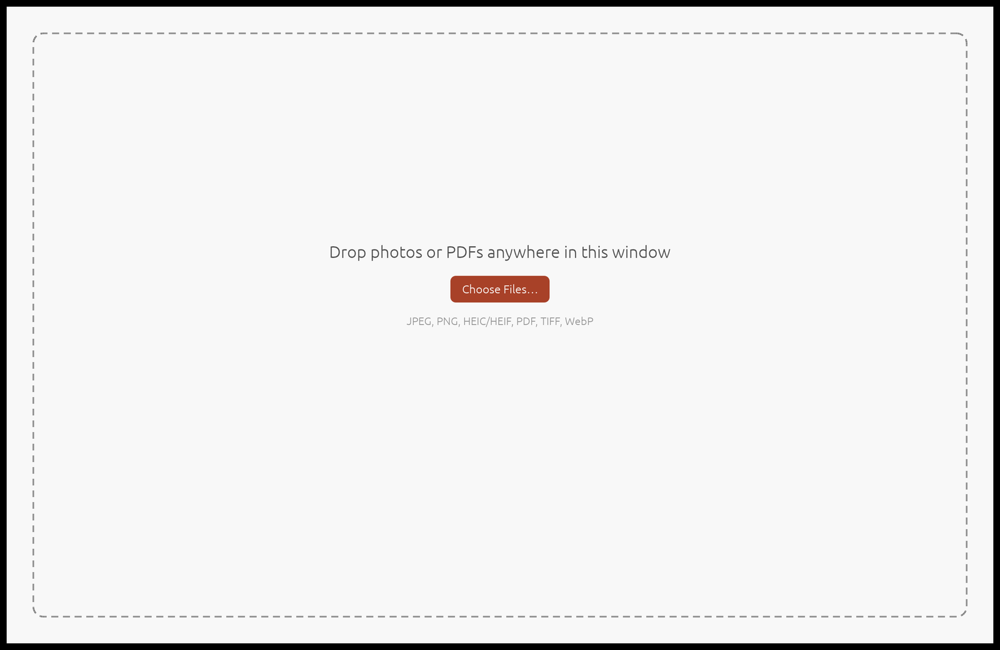
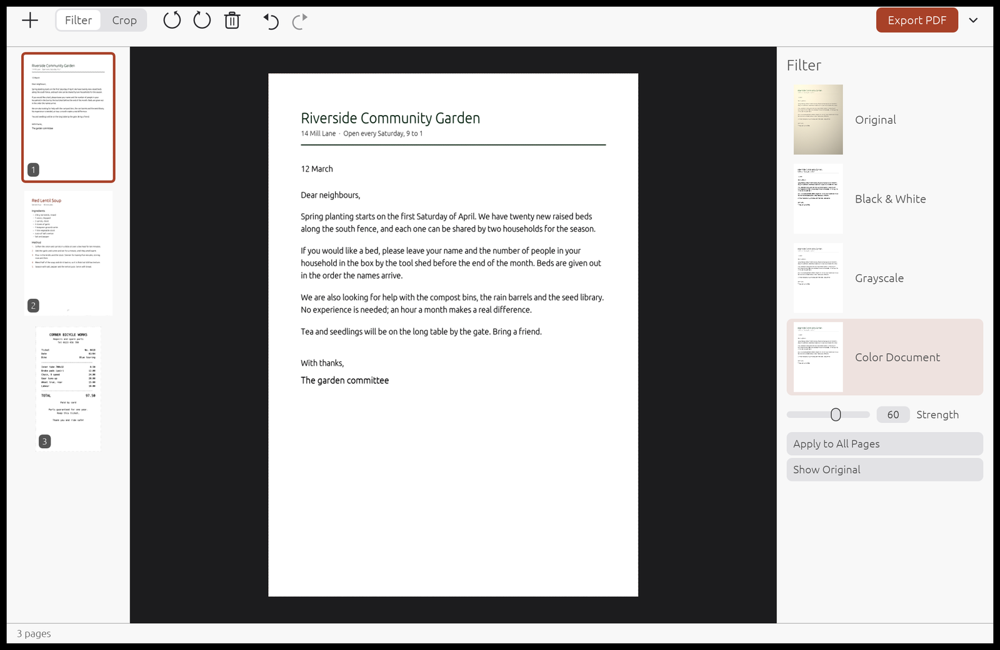
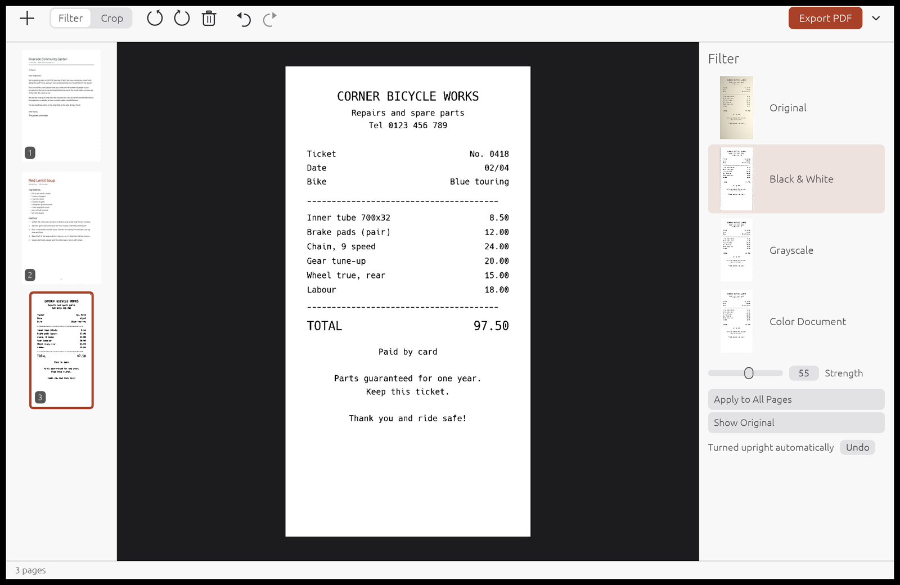

# ScanCraft

ScanCraft turns photos of paper documents into clean, searchable PDFs. Take pictures of letters,
receipts or pages of a book with your phone, drop them into the window, and ScanCraft finds each
page's edges, flattens it (straightening the perspective, and the curl when the page is bent),
evens out the light, reads the text and writes one PDF.

It is a macOS app written in Rust. A command-line tool runs the same engine on macOS and Linux.

## How it works

Everything below comes from one scan of the three phone photos here: a letter shot at an angle, a
recipe page curling up off the table, and a receipt lying sideways.


### 1. Drop in your photos

Drop photos or PDFs anywhere in the window, or press **Choose Files…**. ScanCraft reads JPEG, PNG,
HEIC/HEIF, TIFF, WebP and PDF. If you closed the app halfway through a scan, it offers to pick up
where you left off.



### 2. Every page comes out finished

Each photo becomes a page in the sidebar as soon as it has been read, already cropped, flattened
and cleaned up. You don't need to confirm anything page by page. The letter, photographed at an
angle on a wooden desk, comes out square, with white paper and dark text.

On the right are the four looks a page can have: **Original**, **Black & White**, **Grayscale**
and **Color Document**, each shown as a small preview of this page. The **Strength** slider sets
how hard the clean-up works. **Apply to All Pages** copies the look to the whole document, and
holding **Show Original** shows the photo the page came from.



### 3. Check the edges when you want to

**Crop** shows the photo with the page's outline over it. ScanCraft uses Apple's Vision framework
to find the page, and notices when its sides are curved, as they are on this recipe page. Drag a
corner to move it, drag the handle in the middle of a side to move that side, or double-click the
handle to bend the side.

The same panel decides whether a curved page is flattened (**Automatic**, **Always** or
**Never**), can split a photo of an open book into two pages, and can remove a photo you didn't
mean to add. A page ScanCraft is unsure about is marked in the sidebar, and the status bar counts
the pages that need a look.


Press **Done** and the page is unrolled: the lines of text run straight across, and the shadow
where the page lifted off the table is gone. The panel says what was done, with an **Undo** next
to it.


### 4. Pages come out the right way up

The receipt was photographed on its side. ScanCraft reads the text, finds which way is up and
turns the page, and says so in the panel. Here it is in **Black & White**, which suits receipts
and forms. The toolbar's buttons turn pages left or right, delete them, and undo or redo any
change. Command-click pages in the sidebar to change several at once.



### 5. Export one PDF

**Export PDF** writes every page into one PDF, with the text ScanCraft read laid invisibly under
each page, so you can search the PDF and copy text out of it. The arrow next to the button holds
the export options. When the file is written, ScanCraft shows its size and offers to show it in
Finder, open it, or start a new scan.


## The command-line tool

`scancraft-cli` runs the same engine without a window, on macOS and Linux:

```text
scancraft-cli pdf letter.jpg recipe.jpg receipt.jpg --out Scan.pdf
scancraft-cli pdf book/*.jpg --book --look bw --out Book.pdf
scancraft-cli page photo.jpg --look gray --out page.png   # render one page
scancraft-cli detect photo.jpg --json                     # where the page is in the photo
scancraft-cli commands                                    # every command the app understands
```

Looks are `color` (the default), `gray`, `bw` and `original`. The command-line tool doesn't carry
a text reader, so its PDFs have no text layer. Searchable PDFs come from the Mac app, which uses
the text recognition built into macOS.

## Building

ScanCraft needs a recent stable Rust toolchain. The app itself needs macOS, because it uses Apple's
Vision framework to find pages and read text.

```text
cargo run --release -p scancraft         # the app
cargo run --release -p scancraft-cli -- commands
cargo xtask ci                           # the full check: format, lints, tests, layers
cargo xtask ci -p scancraft-geom         # one package
```

The ScanCraft Application Specification and Build Plan describe what is being built and how. They
are kept with the project notes, outside this repository. Rules for contributors and agents are in
[`AGENTS.md`](AGENTS.md), and the origin and licence of every asset is in
[`ATTRIBUTION.md`](ATTRIBUTION.md).

Licensed under MIT OR Apache-2.0.
