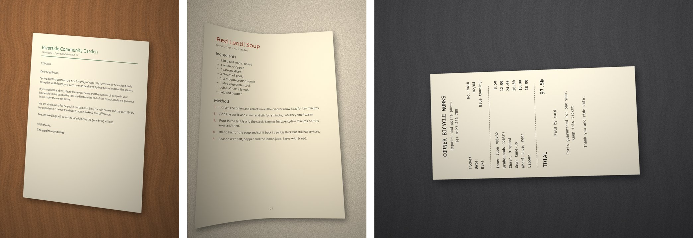
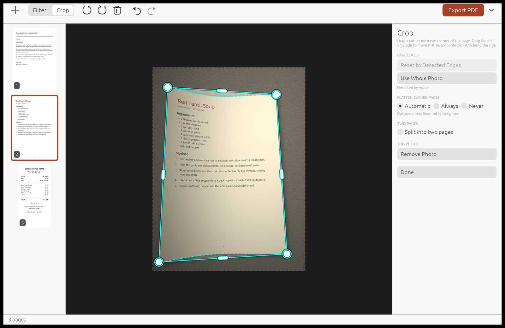
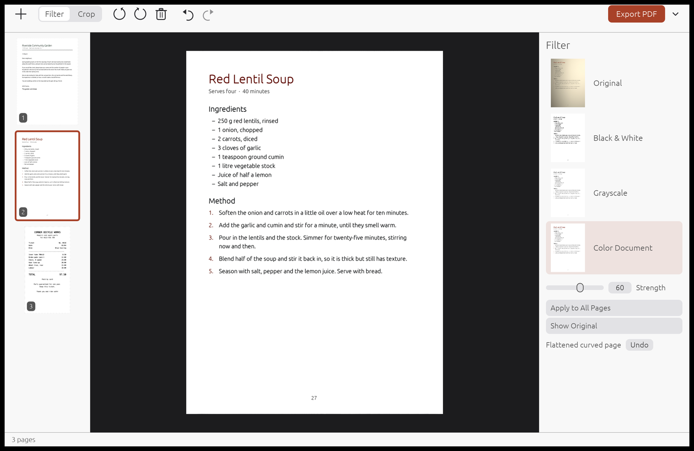
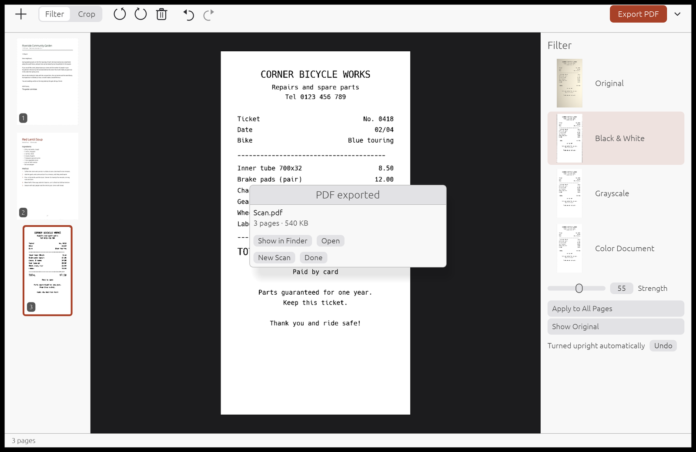

# ScanCraft

ScanCraft turns phone photos of paper documents into clean, searchable PDFs on your Mac.



It finds the page in each photo, straightens it, flattens pages that curl, evens out the lighting,
turns it the right way up and reads the text, so you can search and copy from the finished PDF.

## Add photos

Drop photos or PDFs onto the window, or click **Choose Files…**. ScanCraft opens JPEG, PNG, HEIC,
TIFF, WebP and PDF files. If you quit partway through a scan, it offers to pick up where you left
off.


## Choose a look

Pages are cropped and cleaned up as soon as they're added, with nothing to confirm. Pick a look in
the panel on the right: **Original**, **Black & White**, **Grayscale** or **Color Document**. Use
**Strength** to tune it and **Apply to All Pages** to use it everywhere. Hold **Show Original** to
compare with the photo.


## Fix the crop

Click **Crop** to see the page's outline. Drag a corner or the handle on a side to adjust it, or
double-click a side's handle to bend it to match a curved page. From here you can also choose
whether curved pages get flattened, split a two-page book spread into separate pages, or remove the
photo. Pages that might need checking are marked in the sidebar.



Click **Done**, and a curled page is flattened so its lines of text run straight.



## Rotate, delete and undo

Pages photographed sideways or upside down are turned upright for you. The toolbar rotates and
deletes pages and undoes or redoes any change. ⌘-click pages in the sidebar to change several at
once.


## Export

Click **Export PDF** to save every page into one searchable PDF. More options are behind the arrow
next to the button. When it's done, you can open the file, show it in Finder or start a new scan.



## Command line

`scancraft-cli` does the same processing without a window, on macOS and Linux. Its PDFs don't
include a text layer.

```text
scancraft-cli pdf letter.jpg recipe.jpg receipt.jpg --out Scan.pdf
scancraft-cli pdf book/*.jpg --book --look bw --out Book.pdf
scancraft-cli page photo.jpg --look gray --out page.png
```

Looks are `color` (the default), `gray`, `bw` and `original`.

## Building

The app needs macOS and a recent stable Rust toolchain.

```text
cargo run --release -p scancraft          # the app
cargo run --release -p scancraft-cli      # the command-line tool
cargo xtask ci                            # format, lints, tests
```

Contributors should read [`AGENTS.md`](AGENTS.md). Licensed under MIT OR Apache-2.0.
